# LabourLawyer

**选地区，填信息，生成劳动仲裁文书。**

面向普通劳动者的文书与办事助手。填写仲裁申请书、整理证据清单，再查看当地官方材料要求和提交方式。无需先创建案件或学习管理系统。

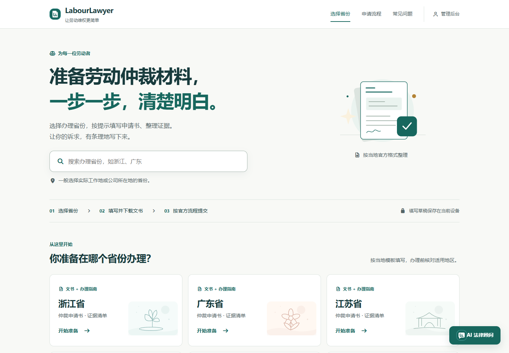

> 本平台是劳动仲裁辅助工具，**不是官方政务服务网站**。文书不保证被受理；管辖、材料和受理条件以当地仲裁机构的最新判断为准。

## 软件下载（预览版）

[下载新版 Android：v1.2.0-preview.1](https://github.com/DerpZhenjun/LabourLawyer/releases/tag/v1.2.0-preview.1) · [Windows 预览版：v1.1.0-preview.2](https://github.com/DerpZhenjun/LabourLawyer/releases/tag/v1.1.0-preview.2)

新版 Android APK 包含本轮 TypeScript 页面与区县表单，为 USB 联调包，签名与旧预览版相同。Windows 仍为上一版安装版和便携版，**后端和官方模板库仍需按本文启动**，AI连接Ubuntu Qwen3.8，不在Windows运行模型。它们不能单独离线生成文书，也不表示全国区县已经接入完成。下载后可用同页`SHA256SUMS.txt`核对文件；详细步骤和实际测试范围见 [Android 新版说明](docs/releases/v1.2.0-preview.1.md)；本轮 USB 设备列表为空，未声称已覆盖安装或完成手机真机验收。

## 从填写到提交

1. 选择省、市、区县或功能区。办理地区须结合工作地、用人单位所在地等确认，不能只按户籍选择。
2. 选择申请书或证据清单。表单提供明确标注的虚构示例，正式使用前替换为自己的信息。
3. 证据从一项开始，按需添加。生成前可确认或取消，确认后下载 Word 文书。
4. 查看当地材料份数、窗口地址和办理方式。核实的官方入口提供跳转；登录或验证码由用户在官网自行完成。

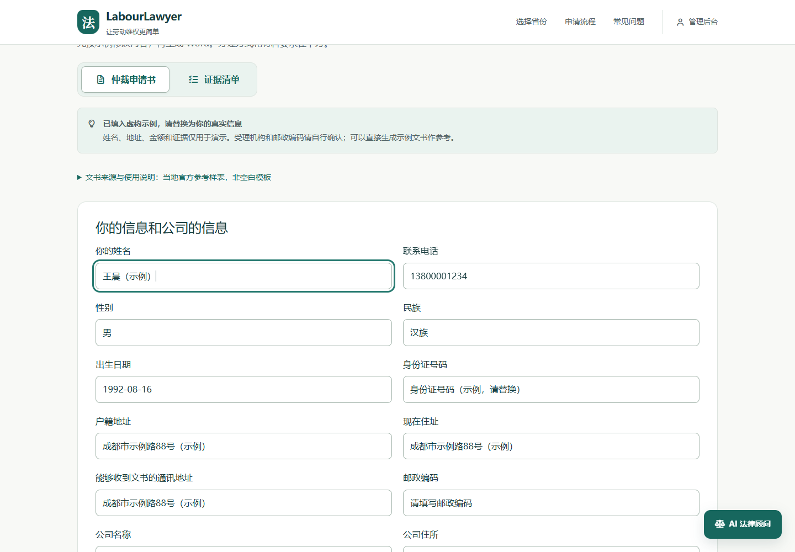

支持未填完整时生成参考文书，提交前仍需补齐材料。官方空白模板、官方样例和平台辅助文书分别标注，不把样例冒充空白表格。

## 每个地区，使用自己的来源

系统按具体地区匹配事项、办理机关、材料和附件，保留官方链接、采集时间、核验状态及文件 SHA-256。切换地区重新查询；没有当地来源时显示待核验，不继承相邻地区的数据。

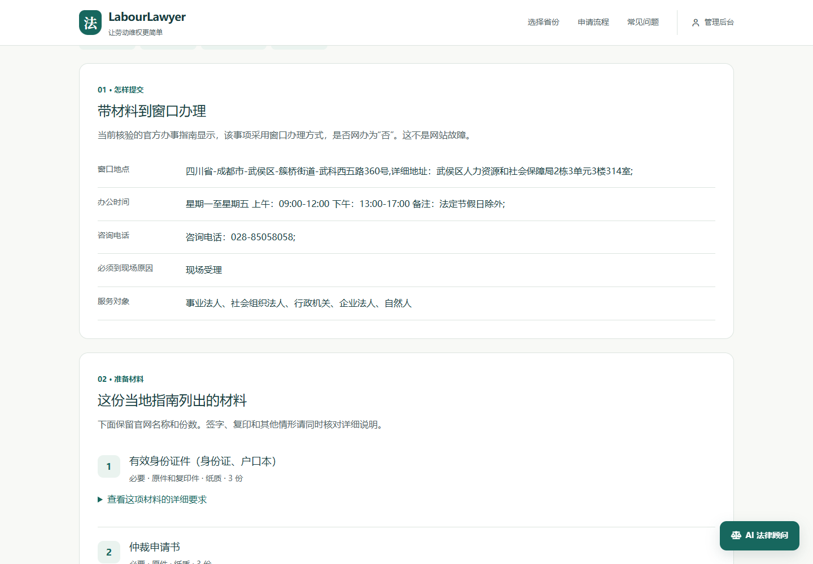

**公开发行数据更新于 2026-10-29。全国区县尚未完成。**

| 范围 | 当前实际状态 |
|---|---|
| 省级入口 | 中国大陆 31 个省级地区；入口存在不代表指南已核验 |
| 地区目录 | 3,974 条目录记录（含省市层级）；目录与候选合并追踪 3,590 个精确地区组合，不是全国功能区完整普查 |
| 已发布当地指南 | 202 地：四川 180、江苏 10、浙江 6、安徽 2、湖南 4 |
| 已发布当地填写生成 | 185 地：四川 164、江苏 10、浙江 6、安徽 1、湖南 4 |
| 仅指南、未开放当地生成 | 17 地 |
| 未发布候选 | 28 地，均不计入上线覆盖 |
| 历史省级文书 | 保留独立入口，须另核对适用范围，不计入区县完成数 |

近期新增滨海县、响水县、杭州市上城区、滨江区和合肥市庐阳区的独立资料。滨海、响水及上城已完成离线填写与逐页版式检查，仍待网页验收。滨江材料栏与流程冲突，庐阳的时限说明存在差异，均保留待核验。临平搜索落到市本级的结果未作为该区指南。新候选未发布，没有任何省份被标记为“全区县完成”。

2026-10-29继续完成东台市、射阳县各自模板的严格生成入口、公开来源摘要及6页版式检查，并通过共享接口的独立数据库生成测试；余杭区完成自身原件和填写件13页检查，修复案号标签与续页表头。三地仍保留候选状态，未把离线或内存接口测试当成已上线网页验收。记录见[本批地区进度](reports/regional-release-20261029/TEST-REPORT.md)。

2026-10-29新增海曙、鄞州、瑶海、肥东、江阴、宜兴、青羊，以及天心和湖南湘江新区对应岳麓事项共9地已增量发布。7个新增生成地区的11类填写结果经真实浏览器下载、逐页检查20页，44项候选网页检查通过；公开源码干净目录再次验证11类生成。当时主站实际接口确认为190/173，原有指南历史和4294条采集任务保留。湖南支持本区劳动者申请书的官方DOC转换填写件，申请书内附证不冒充独立证据清单。[发布回执](reports/nationwide-verification-20261029/PUBLICATION.json)。

雨花、望城、新北、武进已完成各自模板适配，候选站六类文书实际下载、10页版式和375/768/1440响应式检查通过。雨花、望城使用各自劳动者申请书内的证据栏目；新北、武进分别支持自身申请书及独立证据清单。主站已核对新后端标记并增量发布，**该批发布后为194份当地指南、177个地区可填写生成**，保留全部原有指南历史和4294条采集任务。[发布回执](reports/nationwide-verification-20261029-c/PUBLICATION.json)。[本批验收](reports/nationwide-verification-20261029-c/TEST-REPORT.md)。姑苏、吴中、萧山、临安也已增量发布，**该批发布后合计198份当地指南、181个地区可填写生成**。本批七项原生下载的文件与候选SHA完全一致，关联已检查13页；临安仅开放劳动者申请书，不启用未发布证据项，未查到不等于官方没有提供。[本批发布回执](reports/nationwide-verification-20261029-d/PUBLICATION.json)。[后续四区验收](reports/nationwide-verification-20261029-d/TEST-REPORT.md)。全国尚未完成。

相城、吴江、富阳、建德现已按各自官方指南和空白表格接入申请书、证据清单填写，**当前主站合计202份当地指南、185个地区可填写生成**。八份候选原生下载共14页逐页核对，主站八份实际下载SHA逐件相同；保留210行指南历史及4294条采集任务。相城、吴江采用独立的28字段申请表及5项证据填写栏目（另含序号列），独立证据表没有份数栏；富阳4项材料、建德5项材料及两种联系电话分别保留。不因附件同SHA继承地区规则。[本批发布](reports/nationwide-verification-20261029-e/PUBLICATION.json) · [主站验收](reports/nationwide-verification-20261029-e/live-release/RESULT.json)。

后续常熟、张家港、淳安已采集自己的指南和公开原件，仍待填写适配和网页验收；桐庐选区返回省、市事项已拒绝接入，本县来源仍待核验。三份指南和一份发现记录合计四个候选条目，登记后候选总数28。**待核验不等于官方没有提供。**[下一批实际状态](reports/nationwide-verification-20261029-f/SOURCE-INVENTORY.json)。

禅城仅找到历史文书，当前适用性待核实；南海、历下、市中及此前5地继续定位或访问复核。管理页区分未查、已查未找到、官方明确未提供，本轮最后一种结论为0。详见[第一批验收](reports/nationwide-verification-20261029/TEST-REPORT.md)与[第二批来源](reports/nationwide-verification-20261029-b/SOURCE-INVENTORY.json)。

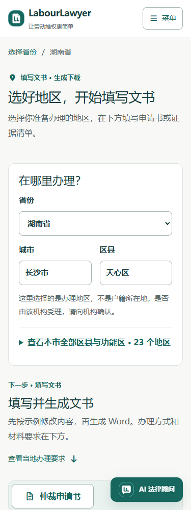

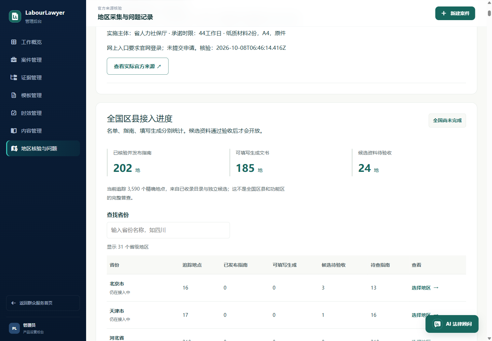

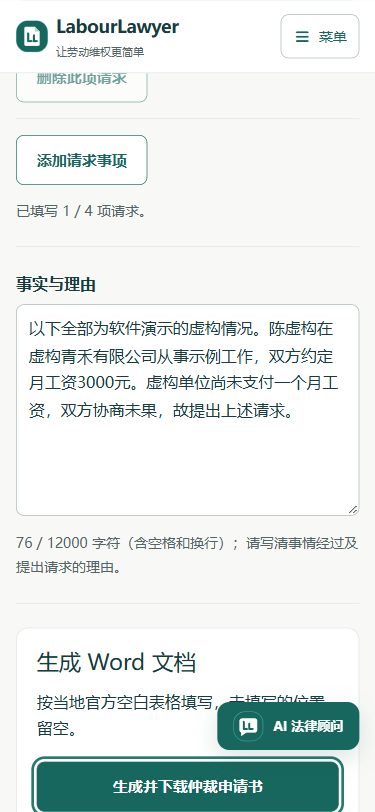

截图为发布验收时点；实时候选数以管理页面为准。

最终全量691项后端测试通过（其中2项权限跳过）；独立Git归档初始化202/185，附件缺失0，45项归档回归通过（1项权限跳过）。[完整交付与下一批](reports/nationwide-verification-20261029-e/FINAL-REPORT.md)。

运行后在 `/admin/regions` 查看实时矩阵。仓库中可核对 [逐省实际进度](docs/regions-status.md)、[公开数据版本](data/public-regions/manifest.json)、[候选登记](config/regional_candidates.json) 与 [地区接入说明](docs/regional-release.md)。

## AI 法律顾问与法律数字人

文字顾问与阿律数字人共用后端的流式问答，通过 SSH 连接 **Ubuntu Ollama / qwen3.8:27b**。Windows 只做连接转发，不启动本机模型；AI中断时仍可填写、生成文书。数字人以右下角客服小窗出现，只显示上半身，可收起后继续填写文书；展开保留对话，并支持可选的浏览器语音朗读。

**2026-10-29 已完成真实网页问答验收**：文字顾问和数字人均通过现有项目后端连接 Ubuntu 的 `qwen3.8:27b`，完整返回测试回答。页面显示连接状态，支持重新检查；远程连接中断不会影响文书填写和生成。已验证 375 / 768 / 1440px 布局。连接、升级后重启和使用说明见 [Ubuntu 远程 AI](docs/remote-ai.md)。

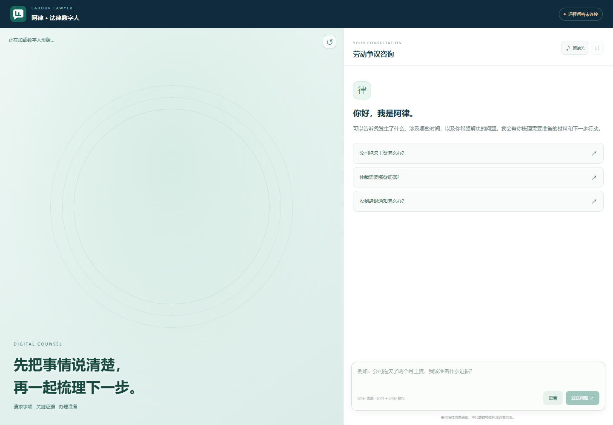

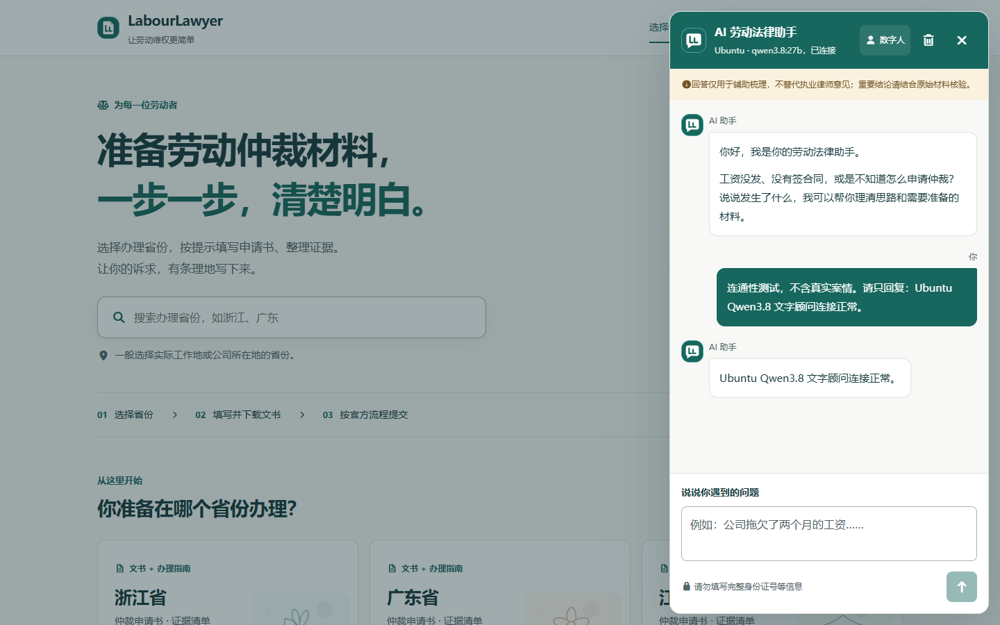

## OpenClaw：公开资料补采与问题追踪

在后台的 **OpenClaw 浏览器补采** 中选择省份，查看或续跑公开指南任务。系统分别记录网页已打开、指南已找到、模板已下载、已验证可填写，保留来源与截图，避免把“下载成功”当成“可以生成”。

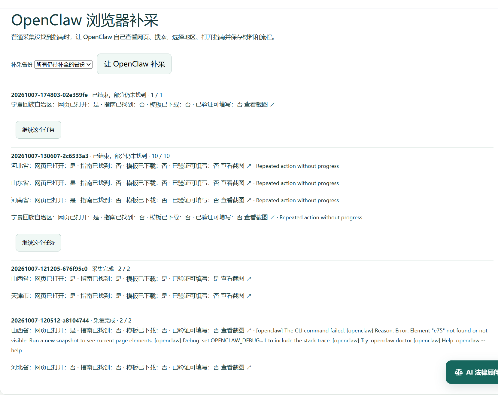

地区核验页展示精确地区、来源版本、采集差异和问题记录。搜索失败、附件缺失、登录边界等问题持久化到 outbox；只有实际收到完整事件编号回执才标记为已接收。

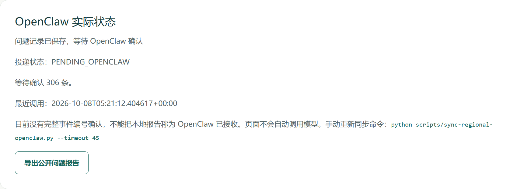

截图中的 `PENDING_OPENCLAW` 表示仍待接收确认；历史任务记录不代表本轮执行了模型视觉复核，也不代表全国完成。截图采集期间没有启动采集或同步。操作入口、CLI与安全边界见 [OpenClaw 功能说明](docs/openclaw.md)。

## 网页、Android 与小程序

| 客户端 | 使用方式与边界 |
|---|---|
| 网页 | Vue 3 + Vite；精确地区选择、当地填写、指南与管理页面 |
| Android | Capacitor 复用网页前端；需构建和安装，可通过 USB 调试安装 |
| 微信小程序 | 原生工程；新增按市、区县查询指南和契约驱动填写生成，保留历史省级入口；正式预览仍需微信开发账号和可访问后端 |
| Windows 桌面 | 可选 Electron 工程；开发模式不等于已发布安装包 |

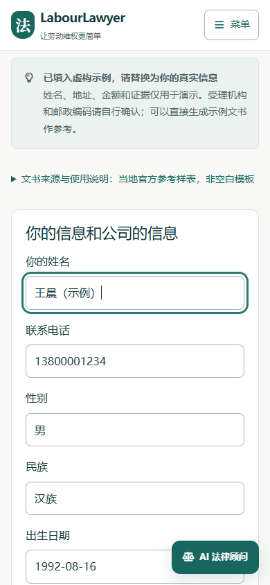

截图来自实际网页，信息均为虚构示例。窄屏网页截图不作为 Android 或微信真机验收证明。

## 快速启动

### Windows

准备 Git、Python 3.11 和 Node.js 22.12+（或兼容 Vite 7 的版本）。Android 构建另需 JDK、Android SDK。

```powershell
git clone https://github.com/DerpZhenjun/LabourLawyer.git
cd LabourLawyer
.\start.bat web
```

也可双击 `start.bat` 打开统一菜单。首次启动会安装缺少的依赖，前后端由同一入口管理，日志位于 `.runtime/`。关闭浏览器不会自动停止服务。

- 网页：<http://127.0.0.1:5173/>
- 地区管理：<http://127.0.0.1:5173/admin/regions>
- API 文档：<http://127.0.0.1:8000/docs>

```powershell
.\start.bat stop
.\start.bat android-open
.\scripts\install-mobile.ps1
.\start.bat mini
```

客户端前置条件见 [三端使用说明](docs/client-guide.md)。小程序使用微信开发者工具，Android 使用 Android Studio / Capacitor。HBuilderX 可以编辑前端，但不是这两个客户端的运行、打包工具。

### 手动启动

```bash
python -m venv .venv
# Windows: .venv\Scripts\activate
source .venv/bin/activate
pip install -r backend/requirements-api.txt
python scripts/bootstrap-public-data.py
python -m uvicorn app:app --app-dir backend --host 127.0.0.1 --port 8000
```

另开终端启动网页：

```bash
cd frontend
npm ci
npm run dev -- --host 127.0.0.1
```

首次启动仅向空的公共指南、地区目录库导入经 SHA-256 校验的发行快照；已有数据不覆盖，不操作案件库。附件缺失或适配身份不匹配时关闭对应生成能力。源码不包含个人案件数据库、登录会话或模型文件。

**生成文书不依赖大模型。** AI问答与数字人为可选模块，连接按 [远程 AI 配置](docs/remote-ai.md) 设置，不需要为了生成 Word 启动或下载模型。

## TypeScript 与跨端字段

34 个 Vue 文件的脚本及主入口、路由、地区目录、历史文书、管理工作区和助手状态已迁入 TypeScript，并通过全量严格类型及模板检查。网页和小程序复用同一份运行时契约，字段从当地已核验模板适配器取得，并绑定地区、来源、版本和文书种类。切区立即清除旧结果，过期契约拒绝生成；旧省级入口保持兼容。

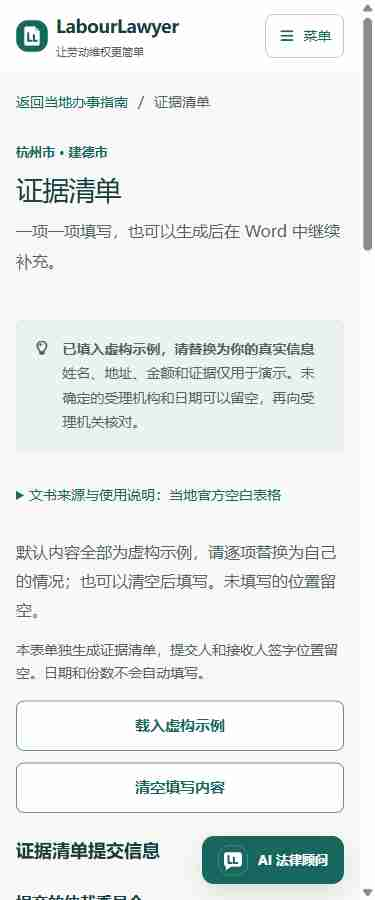

保留必要的 JavaScript 兼容入口和静态 JSON，后台仍使用 Python；本轮没有增加全国覆盖数。新版 APK 和实际测试见 [本轮验收](reports/typescript-frontends-release-20261030/TEST-REPORT.md)。开发、同步和测试命令见 [共享契约说明](docs/typescript-regional-contracts.md)，实测结果见 [本轮验收](reports/typescript-regional-contracts-20261030/TEST-REPORT.md)。

小程序的 7 个页面、应用入口与两个业务工具也已迁入 TypeScript，保留自动生成的微信 JavaScript；严格检查会拒绝产物漂移。网页最后一个旧业务辅助模块完成迁移，三端继续使用同源请求和字段契约。7 页真实模拟器、两份实际 Word 和 34 类旧请求 SHA 对照通过。本轮构建的 83 个网页运行资源与现有 Android 1.2.0-preview.1 完全相同，无需重复发行同一安装包。[本轮小程序迁移验收](reports/miniprogram-typescript-20261030/TEST-REPORT.md)

## 开发与验证

```bash
python -m unittest discover -s backend/tests
node scripts/test-document-clients.cjs
node scripts/test-regional-blank-fields.mjs
npm --prefix frontend run build
```

测试使用临时数据库和虚构信息，不提交真实申请。部分封存采集含官方登录跳转上下文，只留在采集机器；公开克隆会明确跳过对应本地集成测试，不伪造替代证据。构建成功不能代替文书版式和浏览器验收。

`scripts/verify-*.mjs` 使用 Chrome DevTools MCP；设置 `CHROME_DEVTOOLS_MCP_PATH` 为本机安装入口后执行。README 图片由 `scripts/capture-readme.mjs` 实拍。

## 目录

```text
packages/regional-contracts/  网页与小程序共用类型和运行时契约
frontend/            群众网页、地区选择、文书与管理界面
backend/             FastAPI、文书适配、精确地区库与来源核验
templates/_docx/     按省份或具体地区保存的官方原始附件
config/              表单、官方来源目录和候选登记
data/public-regions/ 不含个人资料的公共发行快照
llm_service/         可选 AI 问答
ChatVRM/             可选数字人
mobile/              Android / Capacitor
miniprogram/         微信原生小程序
desktop/             Electron
scripts/             启动、采集、维护与验收
docs/                使用说明与实际页面截图
```

## 新增区县

访问该地区自己的官方事项指南，核对机关、事项与适用范围，展开材料和办理方式，逐一下载公开附件并保存来源和 SHA-256。缺少模板保持缺失，不用其他地区文件替代。

适配须验证地区、事项、附件编号、路径和摘要，在独立测试库检查生成结果，逐页检查文书，并验收桌面和手机宽度的真实网页。通过后才增量发布和导出公共快照。

OpenClaw 记录公开采集问题；不可用时持久化为 `PENDING_OPENCLAW`，有真实回执后才标记同步。不得上传身份信息、真实文书或凭据。详情见 [地区接入与发行说明](docs/regional-release.md)。
