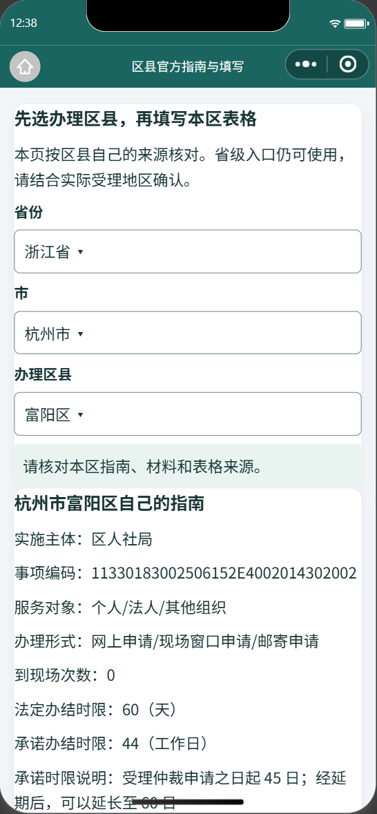
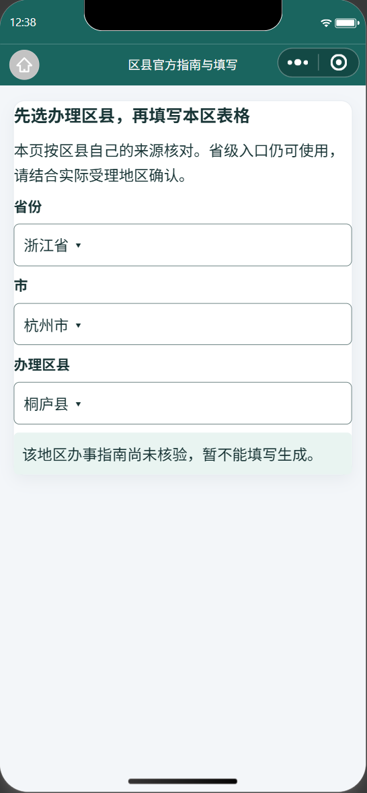

# 小程序与剩余前端业务 TypeScript 迁移

小程序 7 个页面、应用入口、文书工具和区县传输工具共 10 个业务源码现为 TypeScript，使用微信官方 `miniprogram-api-typings 5.2.3` 和锁定的 TypeScript 5.9.3。原生 Page/App 注册不变，没有更换框架或修改 AppID。新增开发依赖与测试目录明确排除在微信打包范围之外，配置调整后的模拟器首页仍显示 31 个省份入口。

微信运行 JavaScript，因此保留同路径编译产物；`npm --prefix miniprogram run compile` 生成，`typecheck` 和 `test` 先严格编译再检查源码 SHA 与产物漂移。四个真实编译反例分别验证页面状态、地区版本、AI 请求与表单容量的错误类型会被拒绝。静态 JSON 和开发脚本仍保留原格式。

网页最后一个旧业务辅助模块也已迁入 TypeScript，保留 JS 重导出以兼容既有调用。网页和小程序共用省级字段、容量与目录 DTO；区县仍使用原有同源契约，AI 请求与数字人代理的同源契约保持。真实省级目录不含本地 `shortName` 的差异已测试，不能因为类型迁移拒绝服务端正常响应。网络 JSON 先验证后使用。

## 本轮实测

| 验证 | 结果 |
|---|---|
| 严格 TypeScript、生成产物检查 | 10 个业务模块、4 个错误类型反例通过 |
| 原有微信模块与数据 | 7 页和 App 可加载，3 份 JSON/JS 数据一致 |
| 区县行为 | 18 项隔离、迟到响应、取消、草稿、容量和来源验证通过 |
| 历史省级文书 | 34 类请求与迁移前运行时 SHA-256 逐项一致 |
| 后端 | 本轮运行相关 33 项，全部通过，47.244 秒 |
| 网页 | 全量严格 Vue 类型、模板检查与生产构建通过；实时相城页 32 个输入控件、无错误遮罩、无横向溢出 |
| 微信真实模拟器 | 7 页正常；富阳和建德使用不同来源及各自版本；桐庐仍待核验 |
| 模拟器生成 | 富阳申请书、证据清单真实请求并保存两份 Word；ZIP CRC 和 Word XML 通过 |
| 干净 Git 归档 | `b8feda43` 的小程序与共享包独立解压后，完整小程序测试通过；依赖使用锁定安装目录的 junction，不冒充全新安装 |

模拟器文件生成测试用 SDK 模拟确认框的“确认”返回，后台请求、保存及 `wx.openDocument` 没有模拟；取消、重复确认与迟到结果由独立 VM 测试覆盖。测试只用空白默认值，逐份恢复原有草稿存储，没有调用模型、上传或发布小程序。Windows Word 的打开操作不算手机原生分享验收。

初次模拟器启动出现微信内部 bridge 的初始化错误，正常重新编译后恢复；测试由固定短等待改为等待当前地区契约实际到达。完整原日志留在本机，没有把超时尝试当成通过证据。

[结构化回归](REGRESSION.json) · [模拟器状态](SIMULATOR.json) · [实际文件校验](DOWNLOADS.json)

## 安装包与保护范围

重新构建的网页 **83 个运行资源与已发布 Android v1.2.0-preview.1 的包内资源逐字节一致**，APK SHA 与原发布回执相同。小程序独立编译产物不进入 Android 包，因此本轮不重复打包、改标签或覆盖 Releases 附件。继续使用 [现有 Android 预览包](https://github.com/DerpZhenjun/LabourLawyer/releases/tag/v1.2.0-preview.1)，仍需电脑后端与 USB 转发。Windows 安装包没有重打包。[逐字节检查](APK-PARITY.json)

本轮不新增地区规则或模板。当前仍为 202 份当地指南、185 地填写生成，210 条历史及 377 条 outbox 保持；用户六项原有未提交修改的原始 SHA 均未变。没有进行手机真机测试，没有启动 Windows 本机模型。
