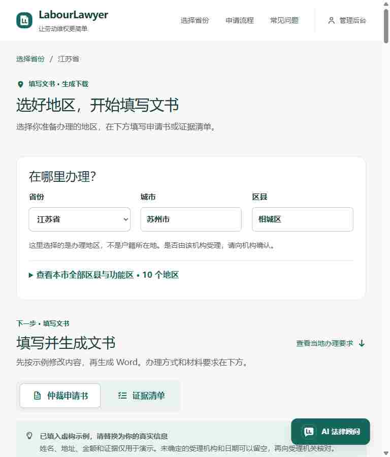

# TypeScript 页面迁移与 Android 预览包验收

本轮覆盖现有 34 个 Vue 文件的脚本、入口和路由，保留兼容 JS 文件与静态 JSON。完整严格 Vue 类型与模板检查、生产构建通过，没有用 `any`、忽略注解或关闭严格检查代替迁移。

## 接口与功能

- 群众页和管理页使用显式 DTO 与未知 JSON 边界校验；地区、来源、版本与模板绑定保持。原件链接新增来源/版本绑定，过期返回 409。
- 历史省级表单迁移前后 34 份请求逐项对比一致；湖南与肥东原有容量、Unicode、固定行版式及原文保留回归通过。
- 坏本地存储不自动覆盖，工作区明确显示示例提示；存储不可用不阻断生成。轮询卸载、地区迟到响应及聊天清空/取消回填均有测试。
- 网页、微信和数字人代理使用同源 AI 请求与远程状态契约。对话测试使用虚构文本与合成流，没有实际推理，也没有启动 Windows 模型。

## 实际验证

| 检查 | 结果 | 记录 |
|---|---|---|
| 全后端 | 共 712 项：710 项通过、2 项跳过，524.674 秒 | [回归](REGRESSION.json) |
| 严格页面/模板 | 全部 34 Vue 脚本、入口、路由及依赖类型通过 | [脚本检查](SCRIPT-CHECKS.json) |
| 群众页 | 12 SFC、5 类型反例、实际挂载和目录取消等通过 | [报告](public-pages/REPORT.md) |
| 管理工作区 | 8 SFC、10 类型反例、12 挂载/运行回归通过 | [报告](workspace-pages/README.md) |
| 省级表单 | 7 SFC、34 份旧/新请求对照及存储/版式边界通过 | [报告](provincial-pages/TEST-REPORT.md) |
| 真实网页 | 12 条页面路径正常；10 份实际文书响应通过 ZIP CRC/XML；8 份区县生成校验来源/版本/契约 | [下载记录](browser/DOWNLOADS.json) |
| 原件与响应式 | 原件 SHA 匹配、过期版本 409；375/768/1440 无横向溢出；原生点击助手后 Escape 正常恢复焦点 | [浏览器结果](browser/RESULT.json) |
| 独立源码归档 | 严格编译、三组页面挂载、共享运行时漂移、AI 合成流与代理通过 | [归档](ARCHIVE-CHECK.json) |
| APK | 包名/版本、签名及旧版证书一致；83 份包内网页文件与构建逐字节一致，ZIP CRC 通过 | [签名](ANDROID-CHECKS.json)、[资源](APK-CONTENTS.json) |

1440px 布局由实时 DOM 检查通过；该尺寸截图保存调用超时，没有把未保存截图写成证据。截图和尺寸测试不等于手机真机验收。

## 修复过程与限制

第一次后端回归遇到旧 VM 导出脚本不能解析 JS 兼容重导出，导致 7 项字段测试未初始化。改为真实导入已迁移 API 后，7 项独立通过，再完整跑完 712 项。没有修改测试来绕过字段要求。

Android 构建复用已安装的 Gradle 缓存与项目既有短临时目录设置；初次使用空缓存和普通临时目录的失败诊断保留在本机，没有关闭 TLS 或更改系统安全策略。

本轮 `adb devices` 无授权设备，所以手机覆盖安装、原生分享未执行；新版提供经过签名和内容核验的 USB 预览 APK。Windows 安装包没有重打包。没有上传或发布微信小程序，也没有重新验证全部 Word 视觉版式；本轮模板填充器及官方附件未变。

地区数据保持 202 份当地指南、185 地可生成、210 条历史与 377 条 outbox，用户六项既有未提交修改保留。没有扩大区县覆盖或把未核验地区写成官方没有资料。Release 不包含后端、模型、官方原件库或用户案件数据库。

## 已公开发布

[Android v1.2.0-preview.1](https://github.com/DerpZhenjun/LabourLawyer/releases/tag/v1.2.0-preview.1) 已公开为预览版，标签指向 `68edcb0241ccc0f0aa755c95c5a2cbfb1bbd0c82`。三个附件均从匿名公开地址重新下载，字节与 SHA-256 全部匹配；见 [发布回执](PUBLICATION.json)。本轮共六批提交（含本回执批次），没有重新标记或覆盖旧版附件。
