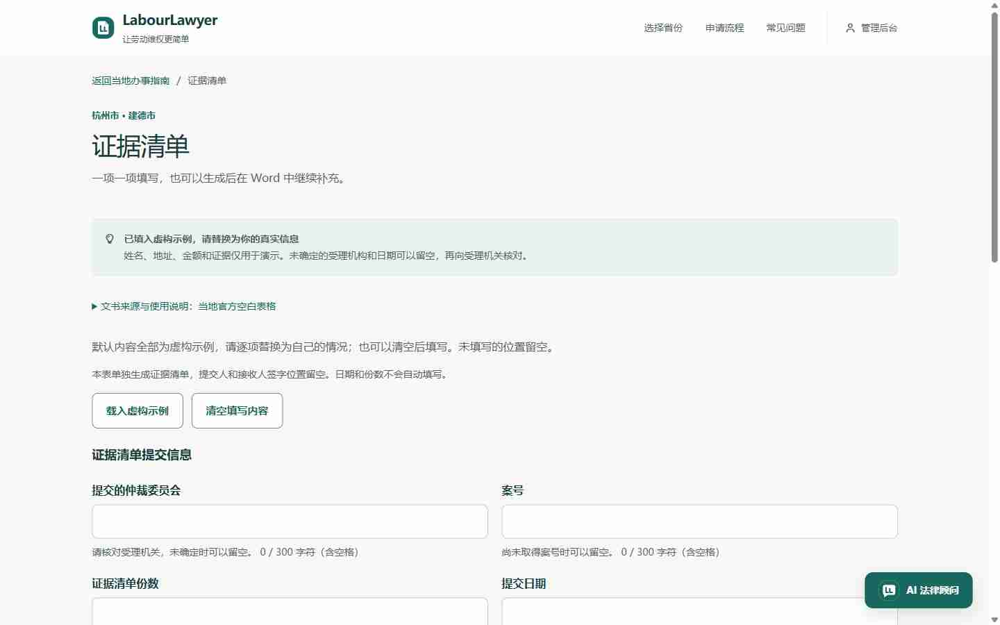

# 区县文书共享契约与 TypeScript 渐进迁移验收

本轮保持 202 份当地指南、185 个可生成地区，没有新增地区覆盖，也没有修改官方附件、来源或既有案件。主站使用原有测试数据目录；不启动 Windows 模型，不调用模型推理。

## 已交付

后端根据各自已核验适配器的实际槽位提供表单契约。网页与小程序使用同源 TypeScript 校验、空白结构、虚构示例和请求构建。地区、来源、版本、模板、文书种类及契约 ID 一同绑定；切区、迟到响应及旧确认回调不能把旧内容下载到新区。旧省级请求保持兼容。

前端已迁移地区 API、表单状态、江苏/浙江字段与草稿模块，以及对应 Vue 字段组件。通用字段由服务端描述驱动，湖南和肥东保留既有专用组件。旧页面逐步迁移，没有宣称全站已完成 TypeScript 化。

小程序新增省、市、区县选择及当地指南、材料、契约表单、原件下载和填写生成。修复微信运行时不支持直接加载 JSON 模块造成的空白页；三份 JS 数据模块由原 JSON 自动生成并校验一致。

## 实测结果

| 检查 | 结果 | 证据 |
|---|---|---|
| 全后端回归 | 712 项通过，2 项跳过，764.148 秒 | [回归记录](REGRESSION.json) |
| 契约及真实生成 | 21 项测试；185 地、364 个真实生成组合 | [后端验收](backend/README.md) |
| Python / TypeScript / 微信 CJS 一致性 | 23 类规格、8,253 组 JSON 向量、202 组形状检查，零差异 | [对照结果](shared-parity/RESULT.json) |
| 类型与组件 | 严格 Vue/TS；12 个错误类型反例被拒绝；江苏 22、浙江 20 项通过 | [字段迁移](frontend-fields/REPORT.md) |
| 页面状态与路由 | 14 项状态/交互及 11 项路由回归通过 | [页面集成](frontend-integration/REPORT.md) |
| 网页实际文书 | 主站 27 次真实界面确认生成；来源、版本、契约 ID、ZIP CRC 和 XML 均通过 | [下载回执](browser/DOWNLOADS.json) |
| 响应式与地区切换 | 375 / 768 / 1440px 无横向溢出；相城切吴江不继承测试输入 | [浏览器结果](browser/RESULT.json) |
| 无可生成资料 | 瑶海仅指南、桐庐尚未核验，均无生成按钮 | [浏览器结果](browser/RESULT.json) |
| 干净 Git 源码 | 契约、类型、页面、路由及 364 真实生成再次通过 | [归档检查](PACKAGE-CHECK.json) |
| 构建与依赖 | 严格类型与 Vite 生产构建通过；当前前端依赖审计 0 漏洞 | [回归记录](REGRESSION.json) |
| 数据保护 | 6 项用户改动、210 条指南历史、377 条 outbox、4,294 项任务保留 | [保护检查](PRESERVATION.json) |

微信开发者工具真实模拟器另已完成富阳、建德两地及桐庐待核验状态的检查：两份实际填写文书下载、原生 Word 打开、原件 SHA 校验、确认取消、单条证据增删、305 字输入保留、跨地区草稿及快速切换均通过。另有 18 项 Page/transport、三份数据一致性和 34 份旧客户端请求回归通过。[模拟器逐项记录与截图](miniprogram-browser/TEST-REPORT.md)。没有把模拟测试写成手机真机或全国逐区验收。

## 问题与修复证据

首次完整回归的两项既有政务浏览器交互遇到超时，原样单独复跑两项通过；随后使用最新代码完整跑完 712 项，没有失败或错误。首轮没有被改写成通过。

跨端对照先发现四川证据示例中的选项值不合法，以及肥东固定行版式对 U+0085 / U+FEFF 的空白处理差异，修复后对照为零差异。审查另发现请求构建可能丢掉已知非枚举字段，已补失败测试并保留该字段；返回文件新增契约 ID 校验。

干净源码检查还发现 Windows 工作区 CRLF 与 Git LF 的源码摘要不一致，已规范 TypeScript 换行并重新生成微信运行时和对照记录。归档中的 `--check` 实际通过。

## 边界

本轮没有重新渲染全部 Word 版式：文书填充器未变，沿用既有适配验收；本轮额外做真实生成、来源身份、ZIP 和 XML 检查。Android、Windows 预览安装包未重新打包，最新迁移体现在网页和小程序源码。没有登录或发布微信小程序，没有代交仲裁申请，也没有声称 OpenClaw 收到了新的事件。
